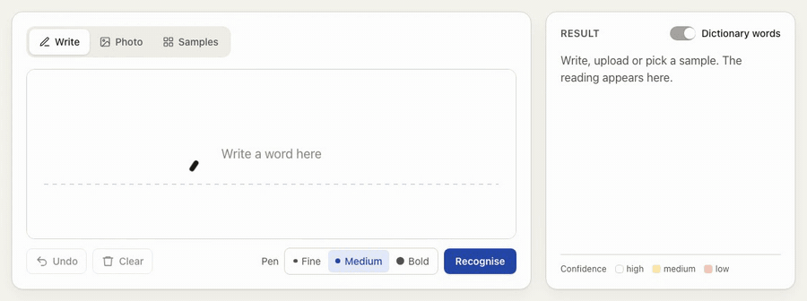
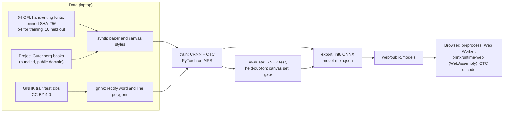
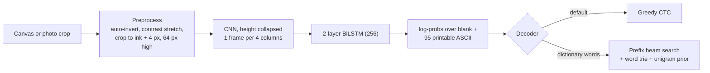

# AccuScan

Handwriting recognition that runs in the browser. Write a word on a canvas, or crop one line from a photo of a note, and a 4-million-parameter CRNN reads it on your device. The repository holds the whole path: synthetic and real training data, training on an Apple-silicon laptop, held-out evaluation against a TrOCR baseline, and a 4.8 MB int8 ONNX model served from a static site.



The recording is automated: Playwright moves the mouse along the pen strokes of the public-domain Hershey fonts (`web/scripts/record-demo.mjs`), so the canvas gets the same pointer events a visitor's mouse produces.

**Live demo:** https://shashank11yadav.github.io/AccuScan/ (GitHub Pages, deployed from `main`)

## How it works





- **One preprocessing, two languages.** `pipeline/src/accuscan/preprocess.py` and `web/src/ml/preprocess.ts` implement the same steps with integer order statistics and an explicit antialiased resampling kernel. A fixture written by the pipeline (`shared/fixtures/preprocess.json`) is checked by both pytest and Vitest to 1e-4, including a photo stored sideways with EXIF orientation 6, an RGBA canvas and a line wide enough to be squeezed.
- **Same decoder on both sides.** Greedy decoding, the prefix beam search and the per-character confidences (a Viterbi alignment) are ported line for line and checked against `shared/fixtures/decode.json`.
- **Training data.** Synthetic lines come in two styles: "paper" (ink texture, uneven lighting, ruled lines, blur, perspective, JPEG artefacts) and "canvas" (white background and a uniform round stroke of random width, redrawn from the glyph skeleton along a wobbly path), so the model has seen input like a visitor's drawing. GNHK words and lines are cropped from their polygons with a perspective warp and upsampled. Training starts on short labels and widens (a curriculum), and keeps the checkpoint with the best GNHK validation CER.
- **In the browser** the model runs in a Web Worker on onnxruntime-web 1.30's WebAssembly build, single-threaded because GitHub Pages cannot send the headers that enable threads. WebGPU is deliberately not used: the int8 operators have no WebGPU kernels, so they would fall back to WebAssembly inside the same session, and the WebGPU build ships a 27 MB runtime instead of 14 MB. A Vite plugin fails the build if any `jsep`, `jspi`, `webgpu` or `asyncify` file reaches `dist/`.

## What it does

- **Write:** draw with a mouse, finger or stylus. The line is read 400 ms after you stop, or on demand. Undo, clear and three pen widths.
- **Photo:** upload a JPEG, PNG or WebP (up to 15 MB), drag a box around one line, and it is read as soon as you let go. EXIF orientation is applied and large photos are downscaled to 2,000 px before any pixel work.
- **Samples:** drawn-style lines in handwriting fonts the model never saw in training, with the true text shown next to the reading.
- Every character is shaded by the model's confidence, and the panel shows the exact 64 px image the network received.
- **Dictionary words** switches greedy decoding to a CTC beam search that only accepts words from a 50,000-word list, falling back to the raw reading when nothing in the list fits.
- Nothing leaves the browser: no server, no analytics, no third-party requests.

## Results

Every number in the tables below is written by `uv run accuscan evaluate` and `uv run accuscan baseline` into `pipeline/reports/` and copied unchanged from `pipeline/reports/metrics.md`. CER is character error rate and WER word error rate (edit distance over reference length; lower is better).

<!-- metrics -->
| Test set | Samples | CER (greedy) | WER (greedy) | CER (dictionary) | WER (dictionary) |
|---|---:|---:|---:|---:|---:|
| GNHK test, words | 8808 | 20.1% | 45.4% | 18.0% | 37.9% |
| GNHK test, lines | 1563 | 21.5% | 55.8% | n/a | n/a |
| Canvas style, held-out fonts | 2000 | 1.4% | 5.8% | 2.5% | 9.4% |

Canvas gate: CER 1.4% against a 15.0% bar, so the demo opens in **free** mode.

Model file 4.81 MB (int8). CPU latency per line, one thread: 3.06 ms at width 128, 5.97 ms at width 256, 11.83 ms at width 512.

| Model | Test set | Samples | CER | WER | Size | ms per crop (CPU) |
|---|---|---:|---:|---:|---:|---:|
| AccuScan CRNN | GNHK test, words | 8808 | 20.1% | 45.4% | 4.81 MB | 5.97 |
| microsoft/trocr-small-handwritten | GNHK test, words | 8822 | 51.4% | 89.0% | 246.4 MB | 80.1 |
| AccuScan CRNN | GNHK test, lines | 1563 | 21.5% | 55.8% | 4.81 MB | 5.97 |
| microsoft/trocr-small-handwritten | GNHK test, lines | 1568 | 38.8% | 73.5% | 246.4 MB | 105.2 |
<!-- /metrics -->

**What the test sets are.** GNHK's official test split (25% of the images, chosen by its authors), cut into word crops and line crops: photographed handwriting from many writers, which this model never saw. The validation set that picked the checkpoint is 10% of GNHK's *training* pages, fixed by page id, so the test split was used once. Lines are harder than single words: the model has to get spacing right, and one bad word fails the whole line for exact match.

**What the canvas number is, and is not.** The 1.4% canvas CER is measured on 2,000 *synthetic* canvas-style lines rendered from 10 handwriting fonts that are never used in training, with book text. It shows the model generalises to unseen letter shapes drawn as a uniform stroke. It is not people writing with a mouse: a mouse gives shakier, more angular strokes than any font. How well the model reads real mouse handwriting is the open question the live demo lets you test. The automated test that writes with Hershey font strokes (below) is closer to that, but it is still a font.

**The canvas gate.** The spec set a ship bar on the canvas set: at a CER of 15% or below the demo opens in free writing, above that it opens with dictionary words on. At 1.4% it opens in free mode. The result is written to `model-meta.json` as `defaultMode`.

**Dictionary mode** helps on GNHK words (CER 20.1% to 18.0%, WER 45.4% to 37.9%) because many misreadings are one letter away from a real word. It hurts on the canvas set (1.4% to 2.5%), whose book text includes names and rare words that the 50,000-word list does not have, so free mode is the right default.

### Comparison with TrOCR, read carefully

`microsoft/trocr-small-handwritten` (MIT) was run **zero-shot**: it was not fine-tuned on GNHK. It was trained mainly on IAM, which is scanned forms written by a few hundred people, while AccuScan was trained on GNHK's own training split plus synthetic lines. The table therefore measures each model as you would use it out of the box on photographed notes, not one architecture against another; a TrOCR fine-tuned on GNHK train could well beat this CRNN on accuracy. Both models read exactly the same perspective-rectified crops (TrOCR before the CRNN's own 64 px preprocessing), with the same filtering of special tokens, printed text and out-of-charset words.

**Why the sample counts differ (8808 vs 8822 words, 1563 vs 1568 lines).** Both runs take their crops from the same function (`gnhk.page_samples`). The CRNN evaluation then passes them through `dataset.to_examples`, which drops a crop when, after scaling to 64 px high, it is too narrow for CTC to emit its label: the network produces one frame per 4 pixel columns and needs at least one frame per character, plus a blank between repeated letters. Fourteen word crops and five line crops fail that check (for example "congratulations" in a crop 8 px wide after scaling, which points to a bad polygon). TrOCR has no such limit, so it is scored on them. They are 0.16% of words and 0.32% of lines, and probably among the hardest crops, so the difference slightly favours the CRNN but cannot explain the gap.

**Size and speed are a fair comparison.** TrOCR-small is a 62M-parameter encoder-decoder, 246 MB in float32, which is what a browser would have to download, against 4.8 MB here. Both latencies are single-threaded CPU medians on the same Apple M4: TrOCR's per crop including its autoregressive decoding, the CRNN's for a 256 px wide input (about one word; a 512 px line takes 11.8 ms).

### Drawn handwriting in the browser

`web/e2e/handwriting.spec.ts` writes three phrases on the canvas by moving the mouse along the strokes of two single-stroke Hershey fonts, then reads them with greedy decoding. In Chromium on an Apple M4:

| Font | "hello" | "portfolio" | "the quick fox" | CER over the three |
|---|---|---|---|---:|
| Hershey Sans (print) | hello | portfolio | the quick fox | 0.0% |
| Hershey Script (joined-up) | hello | portfolio | the quick forc | 7.4% |

The test asserts what passes reliably: the print phrases exactly, and for script "hello" exactly and at most 15% CER over the three. In a wider sweep (two sizes, two pen widths) the print phrases were always exact, while script "portfolio" was read as "porffolio" with the bold pen at a smaller size, and the cursive "x" in "fox" was misread every time.

## Training run

The committed model is the best checkpoint of one run on an Apple M4 (10-core GPU, 16 GB) with PyTorch's MPS backend.

| Step | Time |
|---|---|
| `accuscan synth`: 150,000 training, 3,000 validation and 2,000 held-out-font canvas lines | 3 min 18 s on 8 cores |
| `accuscan gnhk`: GNHK word and line crops | 5 min |
| `accuscan train`: 24 epochs (the configured cap) | 6.6 h of epoch time, including the swap slowdown below; without it, about 5 h. Epochs took about 6 min while labels were short and about 13 min once full lines entered the curriculum |
| `accuscan evaluate` | under 30 s |
| `accuscan baseline`: TrOCR-small on GNHK test, CPU, one thread | 16 min |
| `accuscan export` | seconds |

The best GNHK validation CER was 17.55%, at epoch 23, the last one; it was still improving slowly (17.64% the epoch before), so a longer run might gain a little.

### Lessons learned

- **The MPS allocator cache grew past 18 GB on a 16 GB machine.** Line images have variable width, so batches come in many (batch, width) shapes, and PyTorch's MPS caching allocator kept buffers for each shape it had seen. The run slid into swap and epochs went from about 6 minutes to about 33. The fix (`6342bf3`) releases the cache with `torch.mps.empty_cache()` every 200 steps and after each validation pass; the last ten epochs, on full-length lines, held steady at about 13 minutes.
- **Make long runs resumable before you need it.** Training writes `runs/<run>/last.pt` (model, optimiser, scheduler and random number generator states) after every epoch, and `accuscan train --resume` continues from it bit for bit (`5f3b30e`, with a test that checks a resumed run matches an uninterrupted one). The run above was stopped after epoch 9 to apply the memory fix and resumed without losing work.

## Model card

| | |
|---|---|
| Architecture | CNN (5 stages, height collapsed to 1) + 2-layer BiLSTM (256 per direction) + linear CTC head |
| Parameters | 4,048,448 |
| Input | `image: float32[1, 1, 64, W]`, W a multiple of 4 up to 1024, paper -1 and ink +1 |
| Output | `log_probs: float32[W/4, 1, 96]`, log-softmax over the CTC blank (index 0) and ASCII 32-126 |
| File | `model.onnx`, 4.81 MB: int8 dynamic quantisation of the LSTM, the head and the later convolutions (the first four stay float32 for WebAssembly speed) |
| Training data | GNHK train split (GoodNotes, CC BY 4.0), minus a 10% validation subset; synthetic lines in 54 handwriting fonts under the SIL Open Font License, with text from public-domain Project Gutenberg books and a short modern-word supplement |
| Evaluation data | GNHK test split; 2,000 synthetic canvas-style lines in 10 further OFL fonts never used in training |
| Intended use | Reading one short handwritten English word or line at a time, in a demo |
| Out of scope | Finding text on a page, paragraphs, non-Latin scripts, characters outside printable ASCII (GNHK's pound sign is dropped), anything where errors matter |
| Privacy | Inference runs on the device, in the browser; drawings and photos are never sent anywhere |

**Limitations.**

- **Single lines only.** It reads one line at a time and does not find or segment text. Lines wider than 1024 px at 64 px height (about 25-30 characters) are squeezed, which lowers accuracy, and the app says so.
- **English printable ASCII only.** Accented letters, other scripts and symbols such as the pound sign cannot be output.
- **Photographed handwriting is hard, and GNHK lines are harder than words.** 56.8% of GNHK test words are read exactly (64.3% with the dictionary), but only 13.6% of GNHK lines, where one wrong letter or space fails the whole line.
- **Mouse writing differs from pen.** A mouse gives shaky, angular strokes. The model has seen a canvas style, but rendered from fonts, so real mouse handwriting is not measured here. Cursive and very irregular writing are harder than print.
- **The dictionary** is built from 19th and early 20th century books plus a short modern supplement, so recent words and names may be missing; when the best dictionary reading is implausible, the raw reading is shown instead.

## Privacy

Drawings and photos are processed in the page and in a Web Worker. Nothing is uploaded, stored or logged; there are no cookies and no third-party requests. The production build ships a Content-Security-Policy that allows only same-origin scripts, styles, workers and fetches, plus `'wasm-unsafe-eval'` for WebAssembly.

## v1 to v2

The first version of this repository was a single notebook (`OCR.ipynb`, still in the git history) that fine-tuned NAVER's Donut (`naver-clova-ix/donut-base`) with PyTorch Lightning. The notebook has no saved outputs and was never run end to end, so the accuracy figures in the old README could not be reproduced. It also had a training bug: the tokenizer's pad token was set to the end-of-sequence token, and padding was then masked to -100 in the labels, so the end-of-sequence token was masked too and the model could never learn to stop generating. Its accuracy metric compared characters and words by position rather than by edit distance, so a single missing letter early in a line counted everything after it as wrong.

v2 starts again with a model sized for the browser, training data whose licences allow publishing the weights (IAM is not used: it is for non-commercial research only and forbids redistribution), and evaluation on held-out data with standard CER and WER.

## Running locally

Requirements: Node 24 and [uv](https://docs.astral.sh/uv/). Datasets live outside the repository in `../_datasets/` (override with `--data-dir` or `DATA_DIR`).

```bash
# Frontend only, with the committed model
cd web
npm ci
npm run dev            # http://localhost:5470/AccuScan/
```

### Retraining

GNHK needs its terms accepted on GoodNotes' download page. Put `train_data.zip` and `test_data.zip` (the "paper JSON format" release) in `../_datasets/gnhk/` without extracting them. Times are from the run above on an Apple M4 (10-core GPU, 16 GB).

```bash
cd pipeline
uv sync
uv run accuscan fonts       # 64 pinned font families, 12 MB, under a minute
uv run accuscan synth       # 150k training + 3k validation + 2k held-out-font canvas lines, ~3 min
uv run accuscan gnhk        # GNHK word and line crops, ~5 min
uv run accuscan train       # best checkpoint in runs/main/best.pt, 5-7 h on an M4 (--resume continues)
uv run accuscan evaluate    # reports/metrics.json and metrics.md, under a minute
uv sync --extra baseline
uv run accuscan baseline    # TrOCR-small on GNHK test, CPU, ~16 min
uv run accuscan export      # web/public/models/{model.onnx,model-meta.json,charset.json}
```

`uv run accuscan export --stub` writes a random-weight model with the same I/O contract, and `uv run accuscan smoke` runs the whole chain on tiny data in about 15 seconds. All settings, including the seed, the font split and the gate threshold, are in `pipeline/configs/`. After changing preprocessing or decoding, regenerate the parity fixtures with `uv run accuscan export-fixtures`.

### Tests

```bash
cd pipeline && uv run ruff check . && uv run ruff format --check . && uv run mypy && uv run pytest
cd web && npm run format:check && npm run lint && npm run typecheck && npm test && npm run build && npm run test:e2e
```

Pytest covers preprocessing, decoding, the GNHK reader (on a synthetic dataset in the GNHK format), rendering determinism, font pinning, the ONNX contract, resuming training and the report. Vitest runs the same parity fixtures, the upload and orientation checks, and the committed model through onnxruntime-web. Playwright drives the production build: words drawn along Hershey font strokes, an empty canvas, dictionary mode, the trained model's numbers on the page, a model that returns 404 (error and Retry), unsupported and rotated uploads, selections, samples, keyboard tabs, the CSP, and axe at 1280 and 320 px.

With the production build running (`npm run build && npm run preview`), `npm run screenshot` captures the three tabs at 1280 and 375 px, and `npm run demo-gif` records `docs/demo.gif` (needs ffmpeg).

## Project structure

```
pipeline/
  configs/          default.toml (seed, sizes, gate), fonts.toml (pins, held-out list), resources.toml
  src/accuscan/     preprocess, render, synth, gnhk, model, train, decode, evaluate, baseline, export, cli
  src/accuscan/resources/   bundled public-domain text and the modern-word supplement
  reports/          metrics.json, baseline.json, metrics.md (pipeline output)
  tests/
shared/fixtures/    preprocess.json, decode.json (pipeline output, checked by both languages)
web/
  src/ml/           preprocess, decode, image checks, worker, lexicon, model metadata
  src/components/   WritePad, UploadPanel, SampleGallery, ResultPanel, AboutSection
  public/models/    model.onnx, model-meta.json, charset.json
  public/lexicon/   words.txt.gz
  public/samples/   held-out-font gallery
  e2e/              Playwright tests; fixtures/hershey-glyphs.json holds the Hershey strokes
  scripts/          screenshots and the demo recording
docs/demo.gif
```

## Credits

- **GNHK** (GoodNotes Handwriting Kollection): A. W. C. Lee, J. Chung and M. Lee, "GNHK: A Dataset for English Handwriting in the Wild", ICDAR 2021. CC BY 4.0. https://github.com/GoodNotes/GNHK-dataset
- **Fonts:** 64 handwriting families from [google/fonts](https://github.com/google/fonts), each under the SIL Open Font License 1.1; the list and the pinned commit are in `pipeline/configs/fonts.toml`. The font files are not redistributed here.
- **Text:** five public-domain novels (Austen, Conan Doyle, Carroll, Baum, Twain) for synthetic lines, and nineteen in total for word counts, from Project Gutenberg; see `pipeline/configs/resources.toml`.
- **Word list:** ENABLE2K (public domain), ranked by counts in the books above.
- **Baseline:** [microsoft/trocr-small-handwritten](https://huggingface.co/microsoft/trocr-small-handwritten), MIT.
- **Hershey fonts** (test strokes and the demo recording): created by Dr. A. V. Hershey at the U.S. National Bureau of Standards; data format by James Hurt, Cognition, Inc.; SVG conversion by Windell H. Oskay ([oskay/svg-fonts](https://gitlab.com/oskay/svg-fonts)). Distributed as public domain apart from the NTIS format; the full acknowledgements are in `web/e2e/fixtures/hershey-glyphs.json`.

## License

MIT, see [LICENSE](LICENSE). Data and fonts keep their own licences, listed above.
