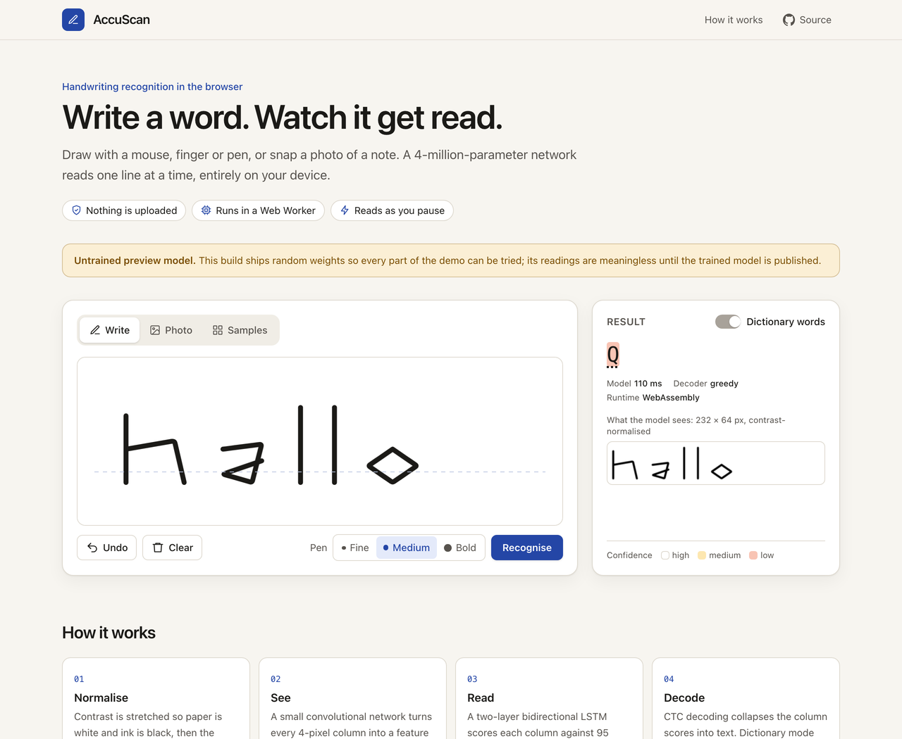
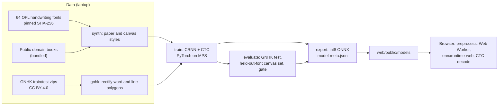
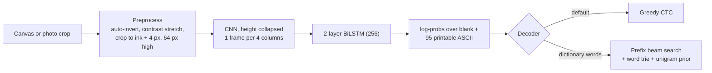

# AccuScan

Handwriting recognition that runs in the browser. Write a word on a canvas, or crop one line from a photo of a note, and a 4-million-parameter CRNN reads it on your device. The repository holds the whole path: synthetic and real training data, training on an Apple-silicon laptop, held-out evaluation against a TrOCR baseline, and a 5 MB int8 ONNX model served from a static site.

<!-- gif -->


**Live demo:** https://shashank11yadav.github.io/AccuScan/ (GitHub Pages, deployed from `main`)

> The model in `web/public/models/` is currently an untrained preview with random weights, so every part of the demo can be exercised before training finishes. The page says so. The numbers below are filled in by `accuscan evaluate` once the trained model is exported.

## What it does

- **Write:** draw with a mouse, finger or stylus. The line is read 400 ms after you stop, or on demand. Undo, clear and three pen widths.
- **Photo:** upload a JPEG, PNG or WebP (up to 15 MB), drag a box around one line, and it is read as soon as you let go. EXIF orientation is applied and large photos are downscaled to 2,000 px before any pixel work.
- **Samples:** drawn-style lines in handwriting fonts the model never saw in training, with the true text shown next to the reading.
- Every character is shaded by the model's confidence, and the panel shows the exact 64 px image the network received.
- **Dictionary words** switches greedy decoding to a CTC beam search that only accepts words from a 50,000-word list, falling back to the raw reading when nothing in the list fits.
- Nothing leaves the browser: no server, no analytics, no third-party requests.

## How it works





- **One preprocessing, two languages.** `pipeline/src/accuscan/preprocess.py` and `web/src/ml/preprocess.ts` implement the same steps with integer order statistics and an explicit antialiased resampling kernel. A fixture written by the pipeline (`shared/fixtures/preprocess.json`) is checked by both pytest and Vitest to 1e-4, including a photo stored sideways with EXIF orientation 6, an RGBA canvas and a line wide enough to be squeezed.
- **Same decoder on both sides.** Greedy decoding, the prefix beam search and the per-character confidences (a Viterbi alignment) are ported line for line and checked against `shared/fixtures/decode.json`.
- **Training data.** Synthetic lines come in two styles: "paper" (ink texture, uneven lighting, ruled lines, blur, perspective, JPEG artefacts) and "canvas" (white background and a uniform round stroke of random width, redrawn from the glyph skeleton along a wobbly path), so the model has seen input like a visitor's drawing. GNHK words and lines are cropped from their polygons with a perspective warp and upsampled. Training starts on short labels and widens (a curriculum) and stops early on GNHK validation CER.
- **In the browser** the model runs in a Web Worker on onnxruntime-web 1.30, with the WebGPU execution provider when the browser exposes a GPU adapter and WebAssembly otherwise (also the fallback if a WebGPU session cannot be created).

## Results

Every number here is written by `uv run accuscan evaluate` and `uv run accuscan baseline` into `pipeline/reports/` and copied from `pipeline/reports/metrics.md`.

<!-- metrics -->
No trained model has been evaluated yet.
<!-- /metrics -->

**Test sets.** GNHK's official test split (25% of the images, chosen by its authors), as word crops and as line crops, and a canvas-style set rendered from 10 handwriting fonts and book passages that are never used in training. A validation subset of GNHK's training pages (10%, fixed by page id) drives early stopping, so the test split is used once.

**The canvas gate.** GNHK only measures photographed handwriting, so the demo's starting mode is decided on the held-out-font canvas set: at a character error rate of 15% or below it opens in free writing, above that it opens with dictionary words on. The result is written to `model-meta.json` as `defaultMode`, and both numbers are reported either way.

**Baseline.** `microsoft/trocr-small-handwritten` (MIT) reads the same rectified GNHK test crops on CPU. It is a 62M-parameter encoder-decoder (about 246 MB in float32) against this model's 4M parameters and 5 MB. If TrOCR is more accurate, the table shows it; the trade-off is a download about 50 times larger and an autoregressive decoder that is slower per word on a laptop CPU.

## v1 to v2

The first version of this repository was a single notebook (`OCR.ipynb`, still in the git history) that fine-tuned NAVER's Donut (`naver-clova-ix/donut-base`) with PyTorch Lightning. It never ran end to end, so the accuracy figures in the old README could not be reproduced. It also had a training bug: the tokenizer's pad token was set to the end-of-sequence token, and padding was then masked to -100 in the labels, so the end-of-sequence token was masked too and the model could never learn to stop generating. Its accuracy metric compared characters by position rather than by edit distance.

v2 starts again with a model sized for the browser, training data whose licences allow publishing the weights (IAM is not used: it is for non-commercial research only and forbids redistribution), and evaluation on held-out data with standard CER and WER.

## Model card

| | |
|---|---|
| Architecture | CNN (5 stages, height collapsed to 1) + 2-layer BiLSTM (256 per direction) + linear CTC head |
| Parameters | 4,048,448 |
| Input | `image: float32[1, 1, 64, W]`, W a multiple of 4 up to 1024, paper -1 and ink +1 |
| Output | `log_probs: float32[W/4, 1, 96]`, log-softmax over the CTC blank (index 0) and ASCII 32-126 |
| File | `model.onnx`, int8 dynamic quantisation of the LSTM, the head and the later convolutions (the first four stay float32 for WebAssembly speed), about 5 MB |
| Training data | GNHK train (CC BY 4.0) and synthetic lines in 54 OFL fonts with public-domain text |
| Intended use | Reading one handwritten English word or short line at a time in a demo |
| Out of scope | Finding text on a page, paragraphs, non-Latin scripts, characters outside printable ASCII (GNHK's pound sign is dropped), anything where errors matter |

**Known limitations.** Lines wider than 1024 px at 64 px height (about 25-30 characters) are squeezed, which lowers accuracy, and the app says so. Synthetic fonts are cleaner than real handwriting, so cursive and very irregular writing are harder. The dictionary is built from 19th and early 20th century books plus a short modern supplement, so recent words and names may be missing; when the best dictionary reading is implausible, the raw reading is shown instead.

## Privacy

Drawings and photos are processed in the page and in a Web Worker. Nothing is uploaded, stored or logged; there are no cookies and no third-party requests. The production build ships a Content-Security-Policy that allows only same-origin scripts, styles, workers and fetches, plus `'wasm-unsafe-eval'` for WebAssembly.

## Running locally

Requirements: Node 24 and [uv](https://docs.astral.sh/uv/). Datasets live outside the repository in `../_datasets/` (override with `--data-dir` or `DATA_DIR`).

```bash
# Frontend only, with the committed model
cd web
npm ci
npm run dev            # http://localhost:5470/AccuScan/
```

### Retraining

GNHK needs its terms accepted on GoodNotes' download page. Put `train_data.zip` and `test_data.zip` (the "paper JSON format" release) in `../_datasets/gnhk/` without extracting them. Times are estimates for an Apple M4 (10-core GPU, 16 GB).

```bash
cd pipeline
uv sync
uv run accuscan fonts       # 64 pinned font families, 12 MB, under a minute
uv run accuscan synth       # 150k training + 3k validation + 2k held-out-font canvas lines, ~5 min on 8 cores
uv run accuscan gnhk        # GNHK word and line crops, ~5 min
uv run accuscan train       # best checkpoint in runs/main/best.pt, ~2-3.5 h on MPS
uv run accuscan evaluate    # reports/metrics.json and metrics.md, ~10-15 min
uv sync --extra baseline
uv run accuscan baseline    # TrOCR-small on GNHK test, CPU, ~30-45 min
uv run accuscan export      # web/public/models/{model.onnx,model-meta.json,charset.json}
```

`uv run accuscan export --stub` writes a random-weight model with the same I/O contract, and `uv run accuscan smoke` runs the whole chain on tiny data in about 15 seconds. All settings, including the seed, the font split and the gate threshold, are in `pipeline/configs/`. After changing preprocessing or decoding, regenerate the parity fixtures with `uv run accuscan export-fixtures`.

### Tests

```bash
cd pipeline && uv run ruff check . && uv run ruff format --check . && uv run mypy && uv run pytest
cd web && npm run lint && npm run typecheck && npm test && npm run build && npm run test:e2e
```

Pytest covers preprocessing, decoding, the GNHK reader (on a synthetic dataset in the GNHK format), rendering determinism, font pinning, the ONNX contract and the report. Vitest runs the same parity fixtures, the upload and orientation checks, and the committed model through onnxruntime-web. Playwright drives the production build: drawing with the mouse, an empty canvas, dictionary mode, a model that returns 404 (error and Retry), unsupported and rotated uploads, selections, samples, keyboard tabs, the CSP, and axe at 1280 and 320 px.

## Project structure

```
pipeline/
  configs/          default.toml (seed, sizes, gate), fonts.toml (pins, held-out list), resources.toml
  src/accuscan/     preprocess, render, synth, gnhk, model, train, decode, evaluate, baseline, export, cli
  src/accuscan/resources/   bundled public-domain text and the modern-word supplement
  reports/          metrics.json, baseline.json, metrics.md (pipeline output)
  tests/
shared/fixtures/    preprocess.json, decode.json (pipeline output, checked by both languages)
web/
  src/ml/           preprocess, decode, image checks, worker, lexicon, model metadata
  src/components/   WritePad, UploadPanel, SampleGallery, ResultPanel, AboutSection
  public/models/    model.onnx, model-meta.json, charset.json
  public/lexicon/   words.txt.gz
  public/samples/   held-out-font gallery
  e2e/
```

## Credits

- **GNHK** (GoodNotes Handwriting Kollection): A. W. C. Lee, J. Chung and M. Lee, "GNHK: A Dataset for English Handwriting in the Wild", ICDAR 2021. CC BY 4.0. https://github.com/GoodNotes/GNHK-dataset
- **Fonts:** 64 handwriting families from [google/fonts](https://github.com/google/fonts), each under the SIL Open Font License 1.1; the list and the pinned commit are in `pipeline/configs/fonts.toml`. The font files are not redistributed here.
- **Text:** five public-domain novels (Austen, Conan Doyle, Carroll, Baum, Twain) for synthetic lines, and nineteen in total for word counts, from Project Gutenberg; see `pipeline/configs/resources.toml`.
- **Word list:** ENABLE2K (public domain), ranked by counts in the books above.
- **Baseline:** [microsoft/trocr-small-handwritten](https://huggingface.co/microsoft/trocr-small-handwritten), MIT.

## License

MIT, see [LICENSE](LICENSE). Data and fonts keep their own licences, listed above.
